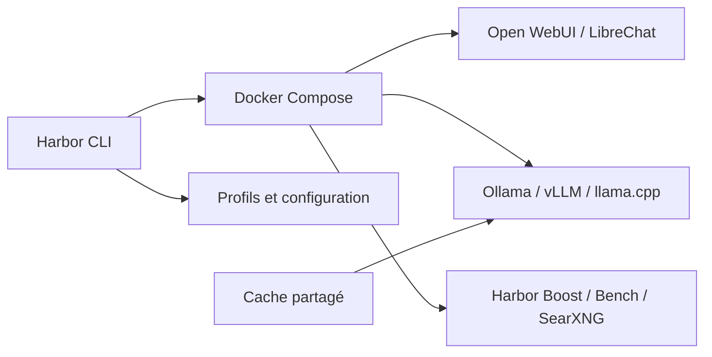

# av/harbor

> CLI that launches a local LLM stack (interfaces, engines, side services) in containers with a single command.

## The problem
Assembling Ollama, vLLM, Open WebUI, SearXNG, etc. with their networks, volumes and configurations takes a lot of hand-written compose.

## What it actually does
Caveat: the repository name comes from an unread header; "av/harbor" is a deduction to be verified, and only the bottom of the README ("single CLI with a lot of services") and the diagram are available. According to the diagram, Harbor CLI orchestrates Docker Compose and manages profiles, configuration and a shared cache (HuggingFace, Ollama). Frontends: Open WebUI, ComfyUI, LibreChat. Backends: Ollama, llama.cpp, vLLM, TabbyAPI. Satellites: Harbor Bench, Harbor Boost, SearXNG. A companion application exists (Harbor App).

## How it is wired

## Trying it
Not documented in the part of the README that was read (the installation commands were not in the excerpt).

## Cost and gotchas
Docker required; GPU for large models (not confirmed in the part read). The repository's license and activity are not readable here (identity block unread).

## What it is not
Not an inference engine: it orchestrates existing engines.

## Alternatives
Not documented in the part of the README that was read.

## For you
Watch: the idea (a reproducible local LLM stack) suits an MLOps profile, but the full README must be re-read before deciding.
