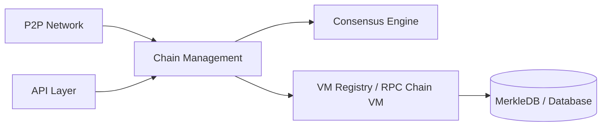

# ava-labs/avalanchego

> Go implementation of a node of the Avalanche blockchain network, for node operators and VM developers.

## The problem
Taking part in the Avalanche network requires running a node that validates blocks and serves the APIs.

## What it actually does
The `avalanchego` binary joins the Mainnet or the Fuji testnet, syncs (several days for a new node, limited by disk I/O), then takes part in consensus. Based on the code described: peer-to-peer network, chain management (P, C, X), virtual machines (including `rpcchainvm` for external VMs), APIs (admin, health, info, keystore) and the MerkleDB database. Version aligned with the network's.

## How it is wired


## Trying it
```bash
git clone git@github.com:ava-labs/avalanchego.git
cd avalanchego
./scripts/run_task.sh build
./build/avalanchego
./build/avalanchego --network-id=fuji
```

## Cost and gotchas
Recommended minimum hardware: 8 vCPU, 16 GiB of RAM, 1 TiB of storage, open public port. Go 1.25.10+ to build. The initial sync takes several days. Go package interfaces may change from one patch to the next.

## What it is not
It is not a stable Go library: the version follows the network's. "Blazing fast" is the README's slogan, with no measurement provided.

## Alternatives
avalanche-cli (named in the README) to launch a local test network.

## For you
Ignore: running a blockchain node brings nothing to data, AI or MLOps work, except targeted on-chain analysis.
