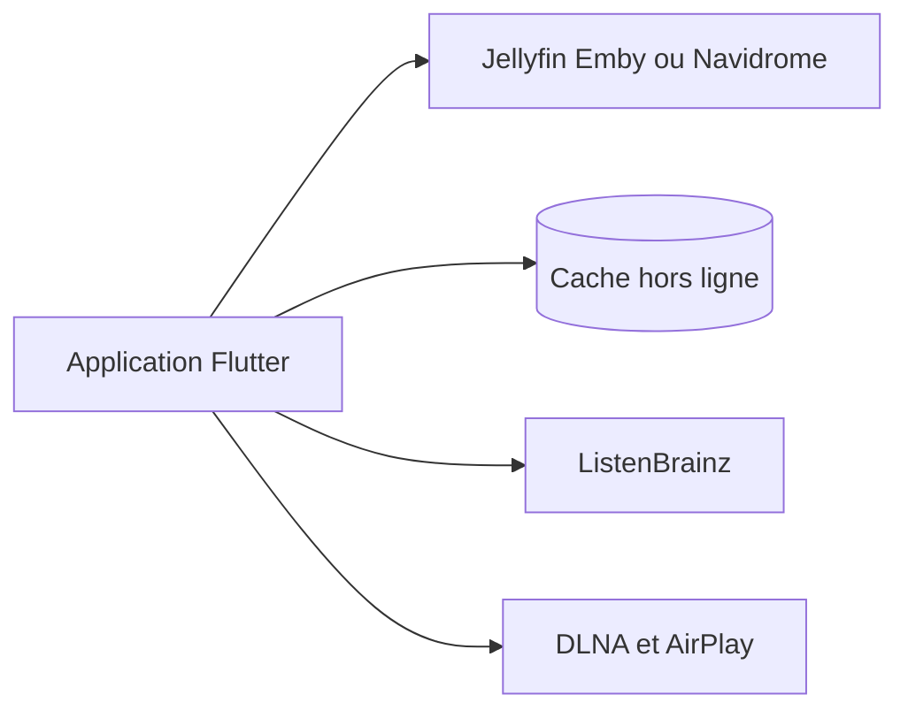

# avdept/JellyBoxPlayer

> Cross-platform music player for Jellyfin, Emby or Navidrome servers, with CarPlay and Android Auto.

## The problem
The official clients of these music servers offer an experience far from a modern streaming app.

## What it actually does
Flutter client for macOS, Windows, Linux, iOS and Android: library browsing, synced favorites, playlists, offline downloads, synced lyrics, ListenBrainz scrobbling, DLNA and AirPlay casting. CarPlay and Android Auto are in beta.

## How it is wired
Simplified diagram based on the sheet, no diagram provided.


## Trying it
```bash
git clone https://github.com/avdept/JellyBoxPlayer.git
cd JellyBoxPlayer
flutter pub get
dart run build_runner build --delete-conflicting-outputs
flutter run
```

## Cost and gotchas
Free, but a running music server is required. The Windows installer is unsigned. On Linux, the libraries bundled with the app still need testing on several distributions.

## What it is not
Not a server: it is a client. Of the OpenSubsonic-compatible servers, only Navidrome is tested.

## Alternatives
Not documented in the README.

## For you
Ignore for a data / AI / MLOps profile: a personal music player, unrelated to your pipelines.
