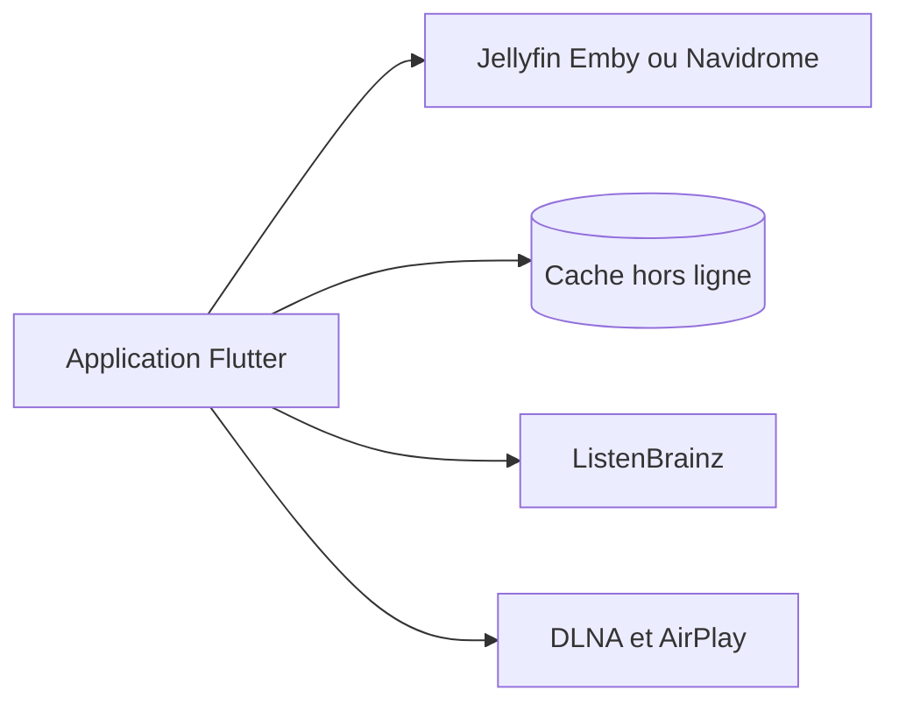

# avdept/JellyBoxPlayer

> Lecteur de musique multiplateforme pour serveurs Jellyfin, Emby ou Navidrome, avec CarPlay et Android Auto.

## Le problème
Les clients officiels de ces serveurs musicaux offrent une expérience peu proche d'une application de streaming moderne.

## Ce que ça fait vraiment
Client Flutter pour macOS, Windows, Linux, iOS et Android : navigation de la bibliothèque, favoris synchronisés, listes de lecture, téléchargements hors ligne, paroles synchronisées, scrobbling ListenBrainz, diffusion DLNA et AirPlay. CarPlay et Android Auto sont en bêta.

## Comment c'est branché
Schéma simplifié d'après la fiche, sans diagramme fourni.


## Essayer
```bash
git clone https://github.com/avdept/JellyBoxPlayer.git
cd JellyBoxPlayer
flutter pub get
dart run build_runner build --delete-conflicting-outputs
flutter run
```

## Coût et pièges
Gratuit, mais un serveur de musique en fonctionnement est indispensable. L'installeur Windows n'est pas signé. Sur Linux, les bibliothèques fournies avec l'application demandent encore des tests sur plusieurs distributions.

## Ce que ce n'est pas
Ce n'est pas un serveur : c'est un client. Seul Navidrome est testé parmi les serveurs compatibles OpenSubsonic.

## Alternatives
Non documenté dans le README.

## Pour toi
À ignorer pour un profil data / IA / MLOps : un lecteur de musique personnel, sans lien avec tes pipelines.

