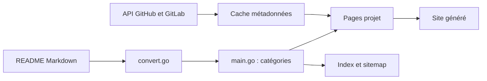

# avelino/awesome-go

> Collaborative directory of Go libraries and software, sorted by category, for Go developers.

## The problem
Choosing a Go library (CLI, database, logging, web…) without knowing what exists or what is maintained.

## What it actually does
A giant README, sorted into dozens of categories (Actor Model, Artificial Intelligence, Database, Web Frameworks…), with one line per project. The repository also contains a Go program that converts the Markdown into a static site: a page per project, index, sitemap, and cached GitHub/GitLab metadata. Additions go through pull requests; the README invites you to report unmaintained packages.

## How it is wired

## Trying it
No command is documented: you browse the list (or the generated site) and open a PR to contribute.

## Cost and gotchas
No cost. The list is huge: a project's presence says nothing about its quality or vitality.

## What it is not
Neither a package registry nor a quality ranking: it is a curated list, with duplicate names (several "jwt", "retry"). Sponsors fund the people who keep the project running.

## Alternatives
- awesome-python: the model it draws on, for the Python ecosystem.

## For you
Adopt as a reference when a Go project awaits you (tooling, ML, MCP): you will quickly find candidates there, to be checked one by one before keeping them.
