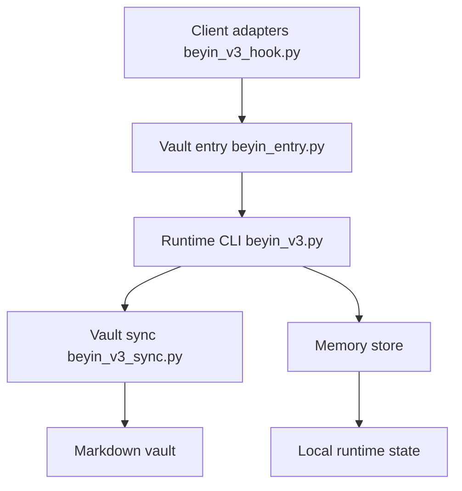

# avenoxai/avenoxbeyin

> Local memory as Markdown notes for your AI agents, shared between Claude Code, Codex and other clients.

## The problem
When you switch agent or session, decisions, tasks and sources are lost.

## What it actually does
A Python installer places in a folder (or an Obsidian vault) an engine, client adapters (hooks) and four skills. Agents write knowledge as Markdown; a local index retrieves notes with their source and provides a bounded context. It also adds keyboard-shortcut capture, a local web view, `doctor`, `update` and an optional advisor named Jev, disabled by default.

## How it is wired



## Trying it
```bash
python3 scripts/install_v3.py --vault "/tam/yol/Beynim"
python3 beyin.py doctor
python3 beyin.py update --check
python3 beyin.py web ac
```

## Cost and gotchas
Python 3.11+ and an AI client already installed; no Mem0, no extra key. The selected context goes to your client's provider. Search is local lexical: recall is not guaranteed. The README is in Turkish.

## What it is not
Not an automatic memory of the whole history: you ask the agent to write what must last. Not a hosted service.

## Alternatives
No alternative named in the README.

## For you
Worth watching: local, verifiable approach to agent memory, but recent and documented mostly in Turkish.
