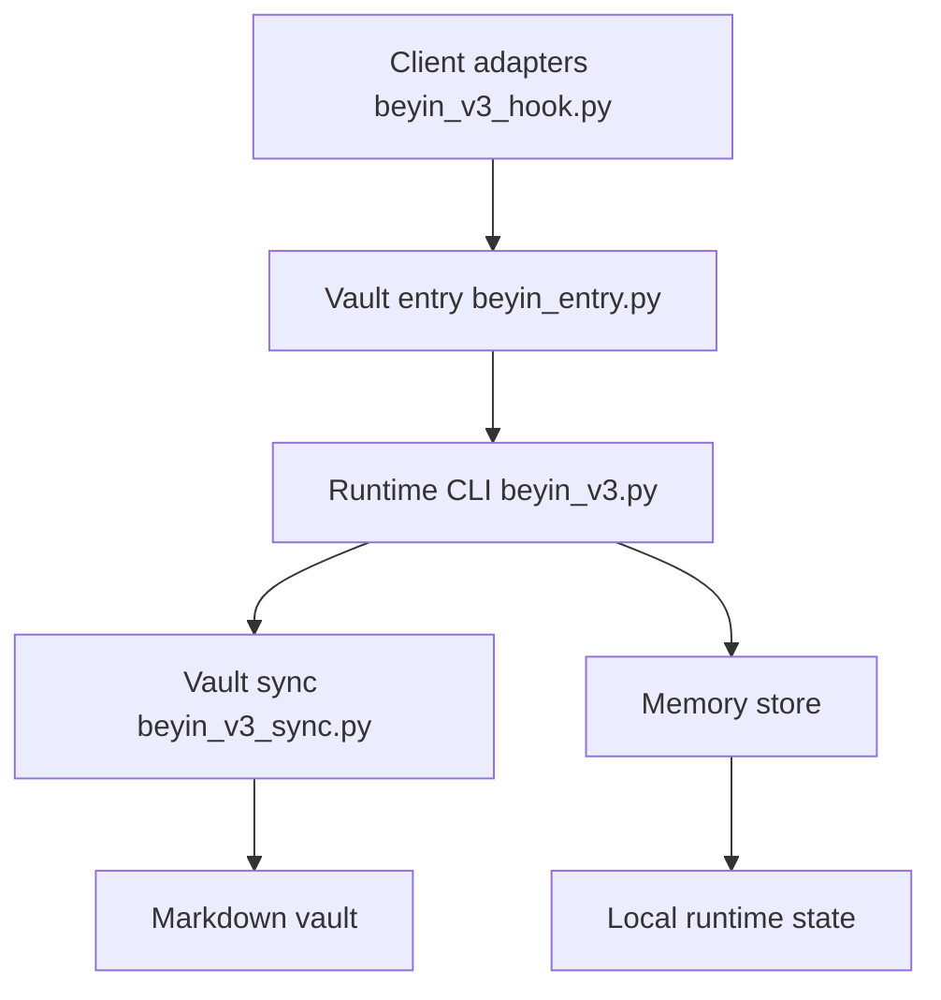

# avenoxai/avenoxbeyin

> Mémoire locale en notes Markdown pour tes agents IA, partagée entre Claude Code, Codex et d'autres clients.

## Le problème
Quand on change d'agent ou de session, les décisions, tâches et sources se perdent.

## Ce que ça fait vraiment
Un installeur Python place dans un dossier (ou un vault Obsidian) un moteur, des adaptateurs de clients (hooks) et quatre skills. Les agents écrivent les connaissances en Markdown ; un index local retrouve les notes avec leur source et fournit un contexte borné. S'y ajoutent une capture par raccourci clavier, une vue web locale, `doctor`, `update` et un conseiller optionnel nommé Jev, désactivé par défaut.

## Comment c'est branché



## Essayer
```bash
python3 scripts/install_v3.py --vault "/tam/yol/Beynim"
python3 beyin.py doctor
python3 beyin.py update --check
python3 beyin.py web ac
```

## Coût et pièges
Python 3.11+ et un client IA déjà installé ; ni Mem0, ni clé supplémentaire. Le contexte choisi part vers le fournisseur de ton client. La recherche est lexicale locale : rappel non garanti. Le README est en turc.

## Ce que ce n'est pas
Pas une mémoire automatique de tout l'historique : on demande à l'agent d'écrire ce qui doit durer. Pas un service hébergé.

## Alternatives
Aucune alternative nommée dans le README.

## Pour toi
À surveiller : approche locale et vérifiable pour la mémoire d'agents, mais récente et documentée surtout en turc.

