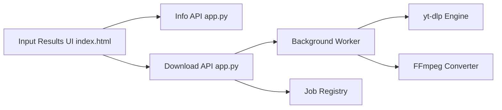

# averygan/reclip

> Self-hosted web interface for downloading video and audio via yt-dlp, intended for personal use.

## The problem
Downloading several videos as MP4 or MP3 from various sites means juggling yt-dlp's command line.

## What it actually does
A Flask backend of about 150 lines calls yt-dlp and ffmpeg; a single HTML page lets you paste URLs, choose MP4 or MP3, the quality, and download in batches. Jobs are kept in memory and files written to disk.

## How it is wired


## Trying it
```bash
brew install yt-dlp ffmpeg
git clone https://github.com/averygan/reclip.git
cd reclip
./reclip.sh
docker build -t reclip . && docker run -p 8899:8899 reclip
```

## Cost and gotchas
Free. Respecting copyright and platform terms is up to you (README warning).

## What it is not
Not an application with accounts or a persistent queue: job state is in memory. It depends entirely on yt-dlp for site compatibility.

## Alternatives
yt-dlp on the command line (direct dependency of the repository).

## For you
Ignore: a thin layer over yt-dlp unrelated to data/AI work, which the command line does just as well.
