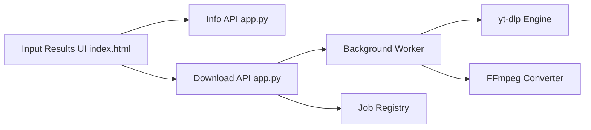

# averygan/reclip

> Interface web auto-hébergée pour télécharger vidéos et audio via yt-dlp, destinée à un usage personnel.

## Le problème
Télécharger plusieurs vidéos en MP4 ou MP3 depuis divers sites demande de jongler avec la ligne de commande de yt-dlp.

## Ce que ça fait vraiment
Un backend Flask d'environ 150 lignes appelle yt-dlp et ffmpeg ; une page HTML unique permet de coller des URL, choisir MP4 ou MP3, la qualité, et télécharger en lot. Les tâches sont gardées en mémoire et les fichiers écrits sur disque.

## Comment c'est branché


## Essayer
```bash
brew install yt-dlp ffmpeg
git clone https://github.com/averygan/reclip.git
cd reclip
./reclip.sh
docker build -t reclip . && docker run -p 8899:8899 reclip
```

## Coût et pièges
Gratuit. Respect du droit d'auteur et des conditions des plateformes à ta charge (avertissement du README).

## Ce que ce n'est pas
Pas une application avec comptes ni file persistante : l'état des tâches est en mémoire. Elle dépend entièrement de yt-dlp pour la compatibilité des sites.

## Alternatives
yt-dlp en ligne de commande (dépendance directe du dépôt).

## Pour toi
À ignorer : fine surcouche de yt-dlp sans lien avec le travail data/IA, que la ligne de commande fait aussi bien.

