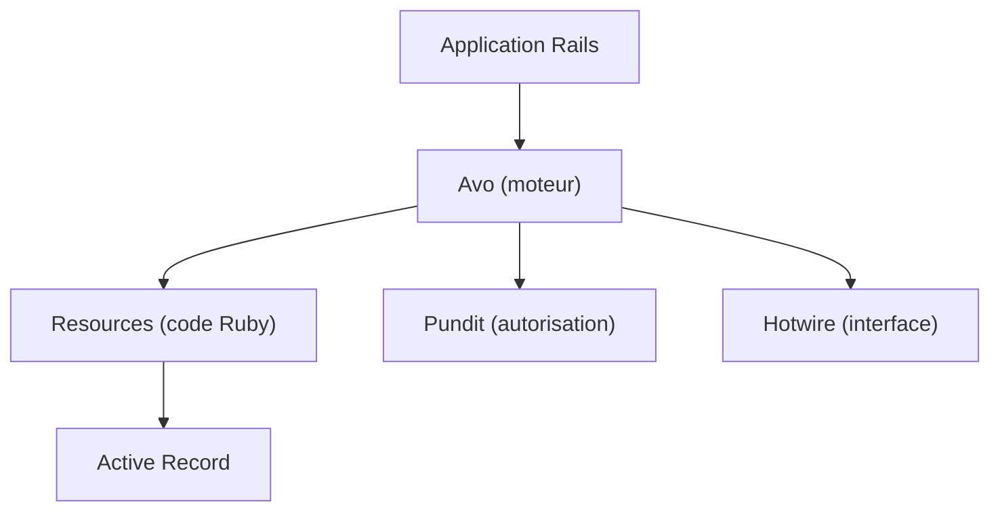

# avo-hq/avo

> Administration framework for Ruby on Rails: CRUD panels, dashboards and internal tools.

## The problem
Building a custom administration interface for a Rails application means writing repetitive controllers and views.

## What it actually does
A Rails engine on Hotwire that generates a CRUD interface from Ruby code. It brings associations, search, filters, actions, metric widgets, Active Storage, authorization via Pundit and grid or tabbed views. It is added to an existing application without modifying its code.

## How it is wired
Simplified diagram based on the card, no diagram provided.



## Trying it
```bash
rails app:template LOCATION='https://avohq.io/app-template'
```

## Cost and gotchas
The README does not detail the paid offer, but the mention of versions and a commercial site suggests an undocumented freemium model. The license is present but not identified by GitHub: read it before use.

## What it is not
It is not a Python or data tool: it assumes a Rails application. It is not a no-code interface generator, configuration goes through Ruby.

## Alternatives
No alternative named in the README.

## For you
Ignore for a data / AI / MLOps profile, unless you maintain an internal Rails application that needs an admin panel.
