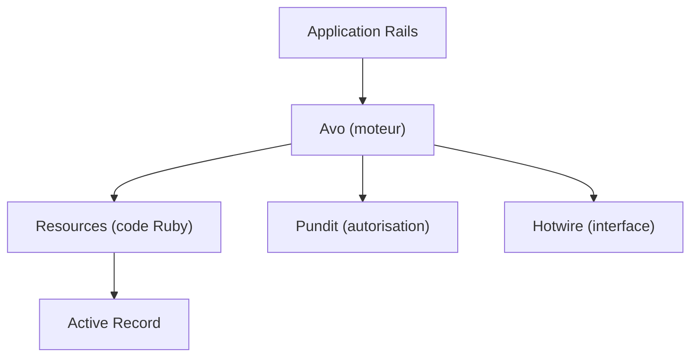

# avo-hq/avo

> Cadre d'administration pour Ruby on Rails : panneaux CRUD, tableaux de bord et outils internes.

## Le problème
Construire une interface d'administration sur mesure pour une application Rails oblige à écrire contrôleurs et vues répétitifs.

## Ce que ça fait vraiment
Un moteur Rails sur Hotwire qui génère une interface CRUD depuis du code Ruby. Il apporte associations, recherche, filtres, actions, widgets de métriques, Active Storage, autorisation par Pundit et vues en grille ou en onglets. Il s'ajoute à une application existante sans modifier son code.

## Comment c'est branché
Schéma simplifié d'après la fiche, sans diagramme fourni.



## Essayer
```bash
rails app:template LOCATION='https://avohq.io/app-template'
```

## Coût et pièges
Le README ne détaille pas l'offre payante, mais la mention de versions et d'un site commercial suggère un modèle freemium non documenté. La licence est présente mais non identifiée par GitHub : à lire avant usage.

## Ce que ce n'est pas
Ce n'est pas un outil Python ni data : il suppose une application Rails. Ce n'est pas un générateur d'interface sans code, la configuration passe par du Ruby.

## Alternatives
Aucune alternative nommée dans le README.

## Pour toi
À ignorer pour un profil data / IA / MLOps, sauf si tu maintiens une application Rails interne qui a besoin d'un panneau d'administration.

