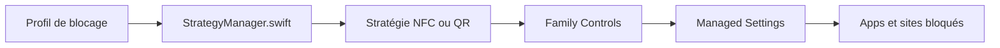

# awaseem/foqos

> Free iPhone app that blocks distracting apps and sites, with unlocking by NFC tag or QR code.

## The problem
Focusing on your phone is hard without physical friction, and competing blockers are paid.

## What it actually does
Uses Apple's Screen Time API to block apps and domains according to profiles. Manual start and stop, by NFC, by QR or barcode, with timer, break or temporary access. Adds widgets, Live Activities, Siri and Shortcuts. Data stays on the device: no account, no tracking, no ads.

## How it is wired


## Trying it
```bash
git clone https://github.com/awaseem/foqos.git
cd foqos
open foqos.xcodeproj
make build
```

## Cost and gotchas
Free for users through the App Store (iOS 17.6 or later). To build it yourself, an Apple developer account with Screen Time and NFC entitlements is required.

## What it is not
Not available on Android (the README cites Switchly and Lock). Not a team productivity tool: blocking is personal. Not affiliated with Brick, Unpluq, Blok or Opal.

## Alternatives
- Brick: paid blocker with dedicated hardware.
- Opal: paid subscription blocker.
- Switchly: for Android.

## For you
Ignore for your line of work: an iOS focus app, useful for personal use only.
