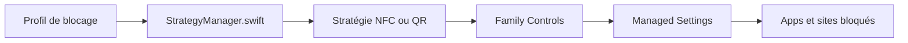

# awaseem/foqos

> Application iPhone gratuite qui bloque apps et sites distrayants, avec déverrouillage par étiquette NFC ou code QR.

## Le problème
Se concentrer sur son téléphone est difficile sans friction physique, et les bloqueurs concurrents sont payants.

## Ce que ça fait vraiment
Utilise l'API Screen Time d'Apple pour bloquer des apps et domaines selon des profils. Démarrage et arrêt manuels, par NFC, par QR ou code-barres, avec minuteur, pause ou accès temporaire. Ajoute widgets, Live Activities, Siri et Raccourcis. Les données restent sur l'appareil : ni compte, ni suivi, ni publicité.

## Comment c'est branché


## Essayer
```bash
git clone https://github.com/awaseem/foqos.git
cd foqos
open foqos.xcodeproj
make build
```

## Coût et pièges
Gratuit côté utilisateur via l'App Store (iOS 17.6 ou plus). Pour compiler soi-même, un compte développeur Apple avec droits Screen Time et NFC est nécessaire.

## Ce que ce n'est pas
Pas disponible sur Android (le README cite Switchly et Lock). Pas un outil de productivité d'équipe : le blocage est personnel. Non affilié à Brick, Unpluq, Blok ou Opal.

## Alternatives
- Brick : bloqueur payant à matériel dédié.
- Opal : bloqueur payant par abonnement.
- Switchly : pour Android.

## Pour toi
À ignorer pour ton métier : app de concentration iOS, utile à titre personnel seulement.

