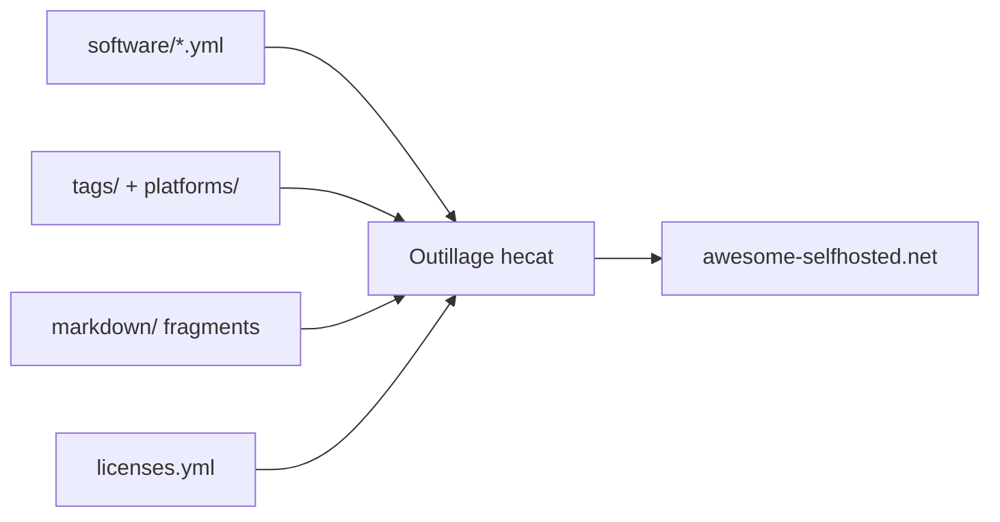

# awesome-selfhosted/awesome-selfhosted-data

> YAML data that feeds the awesome-selfhosted site and list; a catalog of self-hostable software.

## The problem
Maintaining a list of hundreds of self-hosted tools by hand is unmanageable; structured data is needed to generate the site and README.

## What it actually does
The README is two lines long. From the architecture: one YAML file per software under `software`, vocabularies under `tags` and `platforms`, an import/export `.hecat` configuration, Markdown fragments, license files. External tooling generates the list and the site. README insufficient to go further.

## How it is wired

## Trying it
No command documented in the README.

## Cost and gotchas
Free. License not identified by GitHub; schemas and execution order not established by the sources provided.

## What it is not
Not the readable list itself, nor software: a source dataset.

## Alternatives
- awesome-selfhosted: the generated list, cited in the README.

## For you
Keep an eye on it: a handy structured source for spotting self-hosted tools (MLOps, observability), but to be re-read in the generated list.
