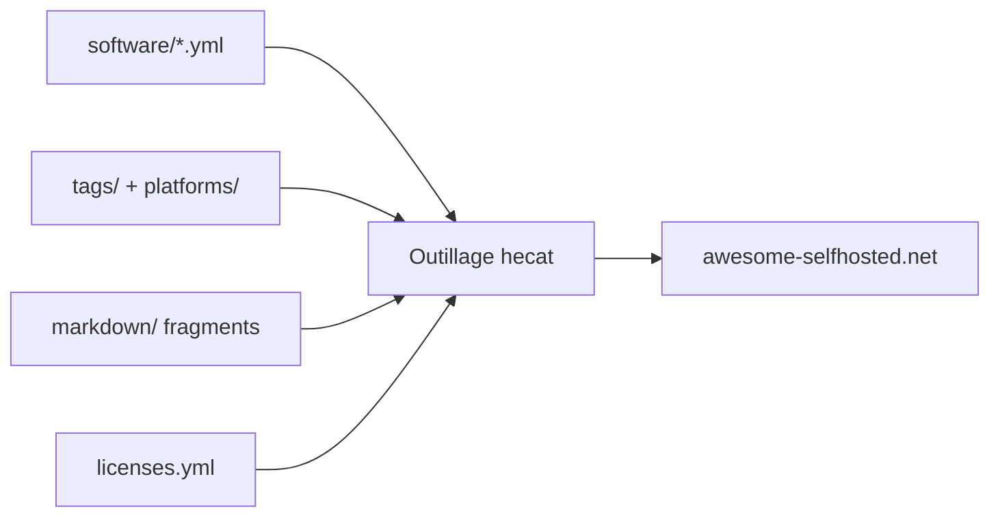

# awesome-selfhosted/awesome-selfhosted-data

> Données YAML qui alimentent le site et la liste awesome-selfhosted ; un catalogue de logiciels auto-hébergeables.

## Le problème
Maintenir une liste de centaines d'outils auto-hébergés à la main est ingérable ; il faut des données structurées pour générer site et README.

## Ce que ça fait vraiment
Le README tient en deux lignes. D'après l'architecture : un fichier YAML par logiciel sous `software`, vocabulaires sous `tags` et `platforms`, configuration `.hecat` d'import/export, fragments Markdown, fichiers de licences. Un outillage externe génère la liste et le site. README insuffisant pour aller plus loin.

## Comment c'est branché

## Essayer
Aucune commande documentée dans le README.

## Coût et pièges
Gratuit. Licence non identifiée par GitHub ; schémas et ordre d'exécution non établis par les sources fournies.

## Ce que ce n'est pas
Pas la liste lisible elle-même, ni un logiciel : un jeu de données source.

## Alternatives
- awesome-selfhosted : la liste générée, citée dans le README.

## Pour toi
À surveiller : source structurée pratique pour repérer des outils auto-hébergés (MLOps, observabilité), mais à relire dans la liste générée.

