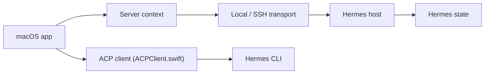

# awizemann/scarf

> Native Mac and iOS app to view and control a Hermes agent, locally or over SSH.

## The problem
The Hermes agent is driven from the terminal and through messaging; its sessions, costs, memory and cron tasks remain hard to see.

## What it actually does
A SwiftUI app that reads Hermes state (`state.db` read-only, config, logs, memory, skills) and routes actions through the `hermes` CLI. Dashboards for sessions, costs and tokens, chat (ACP protocol or terminal), memory and skills editor, cron, MCP servers, messaging platforms, projects with Kanban boards. ScarfGo (iPhone) connects over SSH. Compatible with Hermes v0.6 to v0.21.

## How it is wired


## Trying it
```bash
git clone https://github.com/awizemann/scarf.git
cd scarf/scarf
open scarf.xcodeproj
xattr -d com.apple.quarantine /Applications/Scarf.app
```
Or download the signed version from the Releases.

## Cost and gotchas
Free. Requires Hermes on each host (v0.6+), macOS 14.6+ and, for remote hosts, key-based SSH with `sqlite3` and `pgrep`. The macOS app sends anonymous usage statistics (can be disabled); ScarfGo sends nothing. The sandbox is disabled, so no App Store for the Mac version.

## What it is not
It is not an agent: it is a management client for Hermes. Useless without that agent.

## Alternatives
No alternative named in the README.

## For you
Ignore, unless you already run Hermes: it is an accessory to one specific agent, with no standalone value for data/AI/MLOps.
