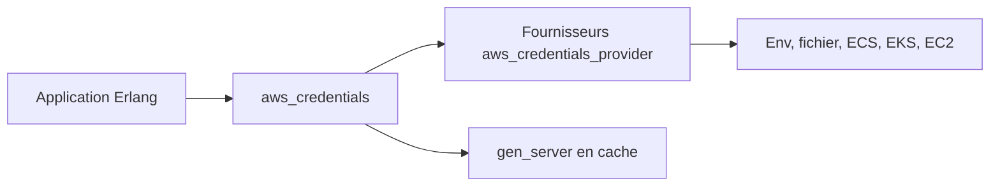

# aws-beam/aws_credentials

> Erlang library that retrieves AWS credentials from seven sources, with automatic refresh.

## The problem
Erlang and Elixir applications must find valid AWS credentials depending on the environment, and renew them.

## What it actually does
Checks in order: Erlang application variables, environment variables, AWS credentials file, ECS, EKS Pod Identity, Web Identity, EC2 metadata. The first valid provider wins. Credentials are cached in a gen_server and renewed five minutes before expiry.

## How it is wired
Simplified diagram based on the sheet, no diagram provided.



## Trying it
```erlang
{ok, _} = application:ensure_all_started(aws_credentials),
Credentials = aws_credentials:get_credentials().
```

## Cost and gotchas
Free, but only useful with an AWS account. Depends on iso8601, jsx and eini. Do not cache the credentials yourself. License present but unidentified.

## What it is not
Not a full AWS client: it only provides credentials.

## Alternatives
No alternative named in the README.

## For you
Ignore: Erlang library, useless in a Python stack where boto3 already handles this.
