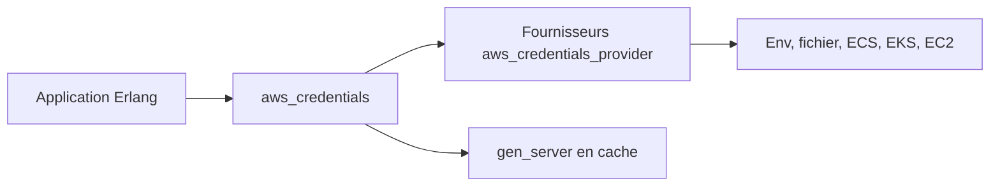

# aws-beam/aws_credentials

> Bibliothèque Erlang qui récupère les identifiants AWS depuis sept sources, avec rafraîchissement automatique.

## Le problème
Les applications Erlang et Elixir doivent trouver des identifiants AWS valides selon l'environnement, et les renouveler.

## Ce que ça fait vraiment
Parcourt dans l'ordre : variables d'application Erlang, variables d'environnement, fichier d'identifiants AWS, ECS, EKS Pod Identity, Web Identity, métadonnées EC2. Le premier fournisseur valide gagne. Les identifiants sont mis en cache dans un gen_server et renouvelés cinq minutes avant expiration.

## Comment c'est branché
Schéma simplifié d'après la fiche, sans diagramme fourni.



## Essayer
```erlang
{ok, _} = application:ensure_all_started(aws_credentials),
Credentials = aws_credentials:get_credentials().
```

## Coût et pièges
Gratuit, mais utile seulement avec un compte AWS. Dépend d'iso8601, jsx et eini. Ne pas mettre les identifiants en cache soi-même. Licence présente mais non identifiée.

## Ce que ce n'est pas
Pas un client AWS complet : il ne fait que fournir des identifiants.

## Alternatives
Aucune alternative nommée dans le README.

## Pour toi
À ignorer : bibliothèque Erlang, inutile dans une pile Python où boto3 gère déjà cela.

