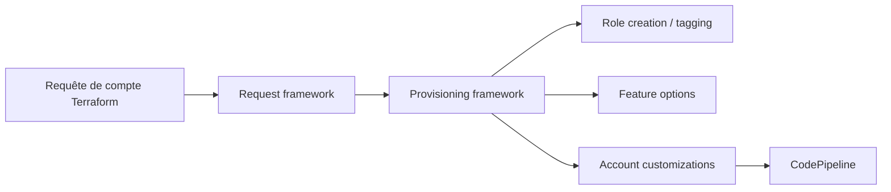

# aws-ia/terraform-aws-control_tower_account_factory

> Terraform module that automates the creation of AWS Control Tower accounts using a GitOps model.

## The problem
Creating and customizing AWS accounts by hand in an organization is slow and inconsistent.

## What it actually does
Deploys the infrastructure of an account factory into a dedicated management account: you write an account request file in Terraform, which triggers provisioning, customizations and options (deleting default VPCs, CloudTrail, enterprise support). Nine internal modules, CodeCommit, GitHub or GitLab code repositories.

## How it is wired

## Trying it
The README describes five steps (landing zone, dedicated OU, AFT-Management account, Terraform, module call); no exact command is given.

## Cost and gotchas
AWS resources are billed; AdministratorAccess credentials required, deployment takes up to 30 minutes. No state backend: keep the state file (it may contain secrets). Anonymous metrics collected since 1.6.0 (can be disabled). With HCP Terraform OIDC, any workspace in the project can assume the `AWSAFTAdmin` role.

## What it is not
Not a multi-cloud solution nor a tool that works without Control Tower.

## Alternatives
No alternative named in the README.

## For you
Watch: relevant if you are industrializing AWS accounts for MLOps platforms; heavy to set up otherwise.
