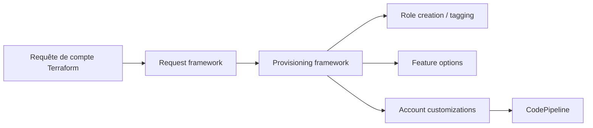

# aws-ia/terraform-aws-control_tower_account_factory

> Module Terraform qui automatise la création de comptes AWS Control Tower selon un modèle GitOps.

## Le problème
Créer et personnaliser à la main des comptes AWS dans une organisation est lent et incohérent.

## Ce que ça fait vraiment
Déploie dans un compte de gestion dédié l'infrastructure d'une usine à comptes : on écrit un fichier de requête de compte en Terraform, qui déclenche l'approvisionnement, les personnalisations et des options (suppression des VPC par défaut, CloudTrail, support entreprise). Neuf modules internes, dépôts de code CodeCommit, GitHub ou GitLab.

## Comment c'est branché

## Essayer
Le README décrit cinq étapes (landing zone, OU dédiée, compte AFT-Management, Terraform, appel du module) ; aucune commande exacte n'y figure.

## Coût et pièges
Ressources AWS facturées ; identifiants AdministratorAccess requis, déploiement jusqu'à 30 minutes. Pas de backend d'état : conserver le fichier d'état (secrets possibles). Métriques anonymes collectées depuis la 1.6.0 (désactivables). Avec OIDC HCP Terraform, tout espace de travail du projet peut assumer le rôle `AWSAFTAdmin`.

## Ce que ce n'est pas
Pas une solution multi-cloud ni un outil sans Control Tower.

## Alternatives
Aucune alternative nommée dans le README.

## Pour toi
À surveiller : pertinent si tu industrialises des comptes AWS pour des plateformes MLOps ; lourd à mettre en place sinon.

