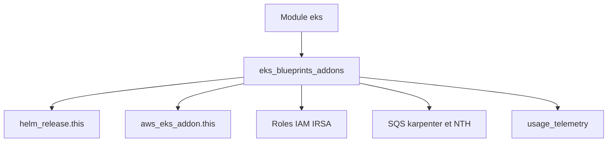

# aws-ia/terraform-aws-eks-blueprints-addons

> Terraform module that installs Kubernetes add-ons (Karpenter, ArgoCD, cert-manager...) on an Amazon EKS cluster.

## The problem
Installing and wiring each EKS add-on by hand (Helm charts, IAM roles, SQS queues) is slow and repetitive.

## What it actually does
A single module with one `enable_*` switch per add-on: Argo, Karpenter, Load Balancer Controller, external-dns, Velero, kube-prometheus-stack, etc. It creates the Helm releases and the associated IAM roles (IRSA). You can add your own charts via `helm_releases`. The README also lists an `aws_cloudformation_stack.usage_telemetry` resource and an `observability_tag`.

## How it is wired

Simplified diagram based on the sheet, no diagram provided.

## Trying it
```bash
# Aucune commande shell : bloc Terraform du README
# module "eks_blueprints_addons" {
#   source  = "aws-ia/eks-blueprints-addons/aws"
#   version = "~> 1.0"
#   ...
#   enable_karpenter = true
# }
```

## Cost and gotchas
Terraform >= 1.3.2, providers aws, helm, kubernetes. An AWS account and an existing EKS cluster are required, the bill is at your expense. The usage telemetry resource is created, which should be checked before deployment.

## What it is not
Does not create the EKS cluster (separate module). Not a multi-cloud tool. Default IAM permissions are broad (ARNs set to `*` for Secrets Manager, SSM, KMS).

## Alternatives
No alternative named in the README.

## For you
Worth watching: useful if you build an MLOps platform on EKS, but narrow the default ARNs and decide on telemetry before applying it.
