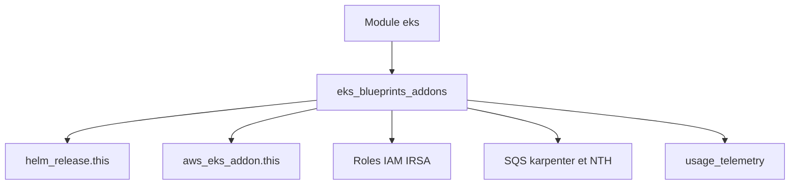

# aws-ia/terraform-aws-eks-blueprints-addons

> Module Terraform qui installe des add-ons Kubernetes (Karpenter, ArgoCD, cert-manager...) sur un cluster Amazon EKS.

## Le problème
Installer et câbler à la main chaque add-on EKS (charts Helm, rôles IAM, files SQS) est long et répétitif.

## Ce que ça fait vraiment
Un module unique avec un interrupteur `enable_*` par add-on : Argo, Karpenter, Load Balancer Controller, external-dns, Velero, kube-prometheus-stack, etc. Il crée les releases Helm et les rôles IAM associés (IRSA). On peut ajouter ses propres charts via `helm_releases`. Le README liste aussi une ressource `aws_cloudformation_stack.usage_telemetry` et un `observability_tag`.

## Comment c'est branché

Schéma simplifié d'après la fiche, sans diagramme fourni.

## Essayer
```bash
# Aucune commande shell : bloc Terraform du README
# module "eks_blueprints_addons" {
#   source  = "aws-ia/eks-blueprints-addons/aws"
#   version = "~> 1.0"
#   ...
#   enable_karpenter = true
# }
```

## Coût et pièges
Terraform >= 1.3.2, providers aws, helm, kubernetes. Un compte AWS et un cluster EKS existant sont requis, la facture est à ta charge. La ressource de télémétrie d'usage est créée, ce qui est à vérifier avant déploiement.

## Ce que ce n'est pas
Ne crée pas le cluster EKS (module séparé). Pas un outil multi-cloud. Les permissions IAM par défaut sont larges (ARN en `*` pour Secrets Manager, SSM, KMS).

## Alternatives
Aucune alternative nommée dans le README.

## Pour toi
À surveiller : utile si tu montes une plateforme MLOps sur EKS, mais réduis les ARN par défaut et décide de la télémétrie avant de l'appliquer.

