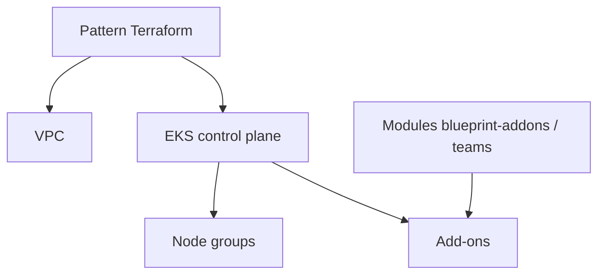

# aws-ia/terraform-aws-eks-blueprints

> Collection of ready-to-adapt Terraform templates for Amazon EKS clusters, aimed at AWS cloud teams.

## The problem
Setting up a complete EKS cluster (tooling, add-ons, access) takes months of integration.

## What it actually does
Provides Terraform "patterns" to browse or copy-paste, not a module to consume as is: few variables, VPC included, everything in a single workspace with targeted apply. Satellite modules: addons, teams, ACK, Crossplane; related projects: data-on-eks, karpenter-blueprints, observability-accelerator.

## How it is wired
No usable diagram provided (no readable component). Description faithful to the README:

## Trying it
No command documented in this README.

## Cost and gotchas
An AWS account is required; the deployed resources (EKS, VPC, nodes) are billed by AWS. The patterns are meant for demonstration.

## What it is not
Not a Terraform module that can be reused as is; nor does it teach Terraform best practices.

## Alternatives
- data-on-eks: blueprints for data workloads on EKS.
- karpenter-blueprints: Karpenter scenarios.

## For you
Worth watching: a good base for setting up an EKS cluster to run ML on, via the data-on-eks link, if you are already on AWS.
