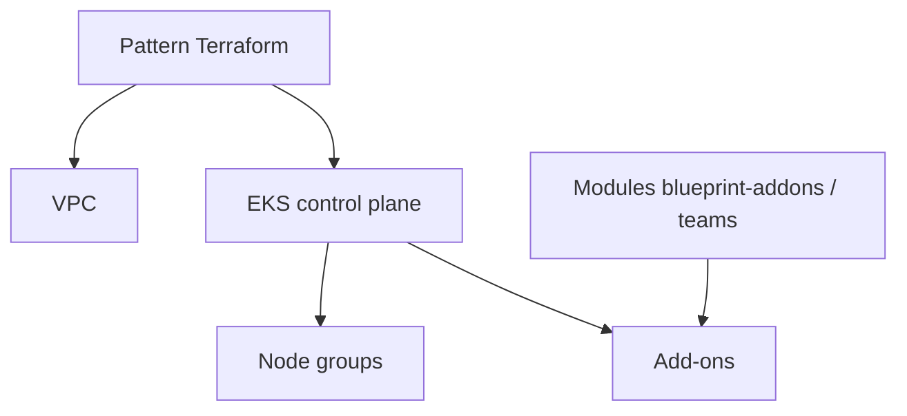

# aws-ia/terraform-aws-eks-blueprints

> Collection de modèles Terraform de clusters Amazon EKS prêts à adapter, pour équipes cloud AWS.

## Le problème
Configurer un cluster EKS complet (outils, add-ons, accès) prend des mois d'intégration.

## Ce que ça fait vraiment
Fournit des « patterns » Terraform à consulter ou copier-coller, pas un module à consommer tel quel : peu de variables, VPC inclus, tout dans un seul espace de travail avec application ciblée. Modules satellites : addons, teams, ACK, Crossplane ; projets liés : data-on-eks, karpenter-blueprints, observability-accelerator.

## Comment c'est branché
Pas de diagramme exploitable fourni (aucun composant lisible). Description fidèle au README :

## Essayer
Aucune commande documentée dans ce README.

## Coût et pièges
Compte AWS requis ; les ressources déployées (EKS, VPC, nœuds) sont facturées par AWS. Les patterns visent la démonstration.

## Ce que ce n'est pas
Pas un module Terraform réutilisable en l'état ; il n'enseigne pas non plus les bonnes pratiques Terraform.

## Alternatives
- data-on-eks : blueprints pour charges de données sur EKS.
- karpenter-blueprints : scénarios Karpenter.

## Pour toi
À surveiller : bonne base pour monter un EKS où faire tourner du ML, via le lien data-on-eks, si tu es déjà sur AWS.

