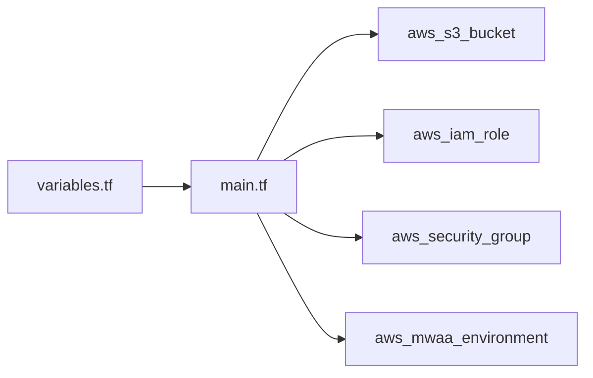

# aws-ia/terraform-aws-mwaa

> Terraform module that deploys an Amazon MWAA environment (managed Airflow), for data teams on AWS.

## The problem
Setting up managed Airflow by hand: S3 bucket, IAM role, security groups, logs and options.

## What it actually does
Creates the MWAA environment and, optionally, its S3 bucket (versioned, encrypted, public access blocked), its IAM role and its security groups; you can bring your own. Parameters: Airflow version, class, min/max workers, schedulers, web server access mode, logs, Airflow options, scripts and `requirements.txt` on S3.

## How it is wired


## Trying it
```hcl
module "mwaa" {
  source = "aws-ia/mwaa/aws"
  name                 = "basic-mwaa"
  airflow_version      = "2.2.2"
  environment_class    = "mw1.medium"
}
```
`vpc_id` and `private_subnet_ids` are also required.

## Cost and gotchas
MWAA is billed hourly by AWS. `PRIVATE_ONLY` by default; `PUBLIC_ONLY` only for testing. Two private subnets required.

## What it is not
Not a self-hosted Airflow deployment, nor a DAG manager.

## Alternatives
No alternative named in the README.

## For you
Adopt if your Airflow orchestration runs on AWS: a Terraform building block maintained by AWS, but keep an eye on the MWAA cost.
