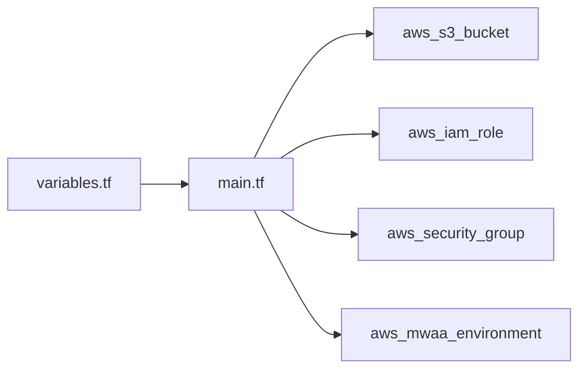

# aws-ia/terraform-aws-mwaa

> Module Terraform qui déploie un environnement Amazon MWAA (Airflow managé), pour équipes data sur AWS.

## Le problème
Monter à la main Airflow managé : bucket S3, rôle IAM, groupes de sécurité, journaux et options.

## Ce que ça fait vraiment
Crée l'environnement MWAA et, au choix, son bucket S3 (versionné, chiffré, accès public bloqué), son rôle IAM et ses groupes de sécurité ; tu peux apporter les tiens. Paramètres : version Airflow, classe, workers min/max, planificateurs, mode d'accès au serveur web, journaux, options Airflow, scripts et `requirements.txt` sur S3.

## Comment c'est branché


## Essayer
```hcl
module "mwaa" {
  source = "aws-ia/mwaa/aws"
  name                 = "basic-mwaa"
  airflow_version      = "2.2.2"
  environment_class    = "mw1.medium"
}
```
Il faut aussi `vpc_id` et `private_subnet_ids`.

## Coût et pièges
MWAA est facturé à l'heure par AWS. `PRIVATE_ONLY` par défaut ; `PUBLIC_ONLY` seulement pour tester. Deux sous-réseaux privés requis.

## Ce que ce n'est pas
Pas un déploiement d'Airflow auto-hébergé, ni un gestionnaire de DAG.

## Alternatives
Aucune alternative nommée dans le README.

## Pour toi
À adopter si ton orchestration Airflow tourne sur AWS : brique Terraform maintenue par AWS, mais coût MWAA à surveiller.

