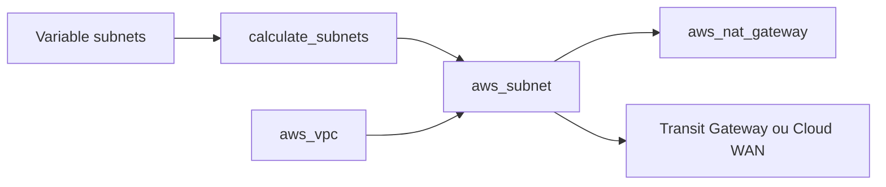

# aws-ia/terraform-aws-vpc

> Terraform module that builds an AWS VPC with public and private subnets, Transit Gateway or Cloud WAN.

## The problem
Splitting a VPC into subnets across several zones, with NAT and routes, is slow and easy to get wrong.

## What it actually does
From a `subnets` table, computes the IPv4 and IPv6 CIDRs by netmask or takes explicit ones, then creates subnets, route tables, NAT, internet gateway, egress-only gateway, Transit Gateway and Cloud WAN attachments, flow logs and VPC Lattice association. NAT EIPs can come from a BYOIP pool or from existing IPs.

## How it is wired
Simplified diagram based on the sheet, no diagram provided.



## Trying it
```hcl
module "vpc" {
  source  = "aws-ia/vpc/aws"
  version = ">= 4.2.0"
  name       = "multi-az-vpc"
  cidr_block = "10.0.0.0/16"
  az_count   = 3
}
```

## Cost and gotchas
AWS account; NAT gateways and Transit Gateway are billed. In production, prefer explicit `cidrs`: with `netmask`, adding a subnet can shift the others and recreate them.

## What it is not
Not a network monitoring tool. The examples show the subnet computation, not a production-ready network.

## Alternatives
No alternative named in the README.

## For you
Adopt if you build your ML infrastructure on AWS: a reproducible network base. Hard-code the CIDRs before production.
