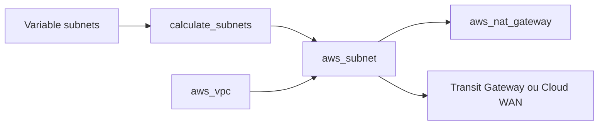

# aws-ia/terraform-aws-vpc

> Module Terraform qui construit un VPC AWS avec sous-réseaux publics, privés, Transit Gateway ou Cloud WAN.

## Le problème
Découper un VPC en sous-réseaux sur plusieurs zones, avec NAT et routes, est long et facile à rater.

## Ce que ça fait vraiment
À partir d'une table `subnets`, calcule les CIDR IPv4 et IPv6 par masque ou les prend explicites, puis crée sous-réseaux, tables de routage, NAT, passerelle Internet, passerelle egress-only, attachements Transit Gateway et Cloud WAN, flow logs et association VPC Lattice. Les EIP des NAT peuvent venir d'un pool BYOIP ou d'IP existantes.

## Comment c'est branché
Schéma simplifié d'après la fiche, sans diagramme fourni.



## Essayer
```hcl
module "vpc" {
  source  = "aws-ia/vpc/aws"
  version = ">= 4.2.0"
  name       = "multi-az-vpc"
  cidr_block = "10.0.0.0/16"
  az_count   = 3
}
```

## Coût et pièges
Compte AWS ; passerelles NAT et Transit Gateway facturées. En production, préfère des `cidrs` explicites : avec `netmask`, ajouter un sous-réseau peut décaler les autres et les recréer.

## Ce que ce n'est pas
Pas un outil de supervision du réseau. Les exemples montrent le calcul des sous-réseaux, pas un réseau prêt pour la production.

## Alternatives
Aucune alternative nommée dans le README.

## Pour toi
Adopter si tu poses ton infra ML sur AWS : base réseau reproductible. Mets les CIDR en dur avant la production.

