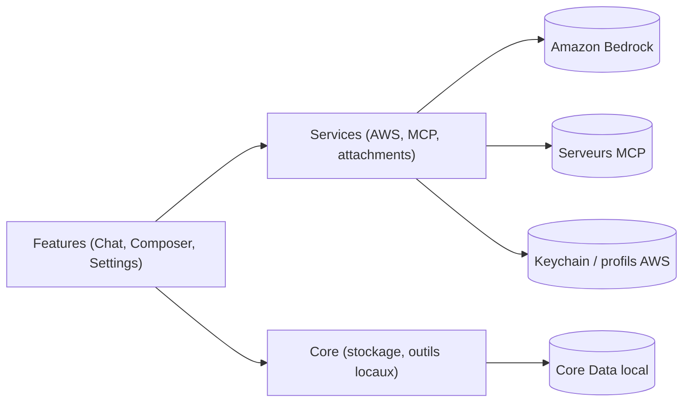

# aws-samples/amazon-bedrock-client-for-mac

> Native Mac app (Swift) for chatting with Amazon Bedrock models, with local tools and MCP.

## The problem
Using Bedrock requires a console or code: there is no desktop client to chat, attach documents and generate images.

## What it actually does
Chat client with model selection, attachments, local history and search, message queue, skills (`SKILL.md`), built-in tools (files, shell, Git) with approval settings, MCP connections (stdio, HTTP), scheduled automations and a demo library. Data stays on the Mac; requests go directly to Bedrock.

## How it is wired


## Trying it
```bash
brew tap didhd/tap
brew install amazon-bedrock-client
aws sso login --profile your-profile
python3 scripts/ci.py
```

## Cost and gotchas
Inference is billed by AWS; you need a profile with Bedrock access, macOS 14+ and network access. Local tools are enabled with permissive access by default, and the shell runs with your rights.

## What it is not
Not an offline or multi-provider client: it targets Bedrock. Video generation requires an output S3 bucket.

## Alternatives
The README names no alternative.

## For you
Watch: a handy desktop client if you work on Bedrock, but its permissive local access by default means you should tighten the settings.
