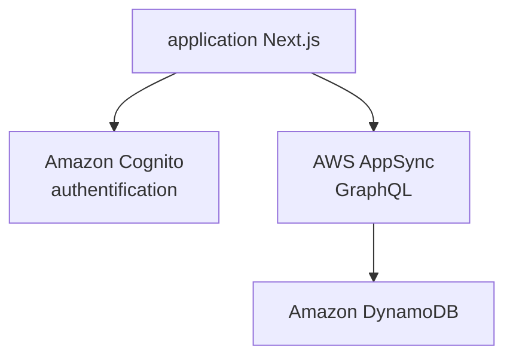

# aws-samples/amplify-next-template

> Next.js (App Router) starter template with AWS Amplify: authentication, GraphQL API, database.

## The problem
Wiring Cognito, AppSync and DynamoDB into a Next.js application by hand takes time.

## What it actually does
Provides a Next.js application preconfigured with Amplify: Amazon Cognito authentication, an AWS AppSync GraphQL API and a DynamoDB database. Deployment is deferred to the Amplify documentation. Very short README.

## How it is wired
Simplified diagram based on the fiche, no diagram provided.

## Trying it
No command documented in the README.

## Cost and gotchas
AWS account required; AWS services are billed by usage. Last push in December 2024.

## What it is not
Not a finished application, only a template. No deployment instructions in the README.

## Alternatives
Not documented in the README.

## For you
Ignore: an old AWS web template, unrelated to data, AI or MLOps work.
