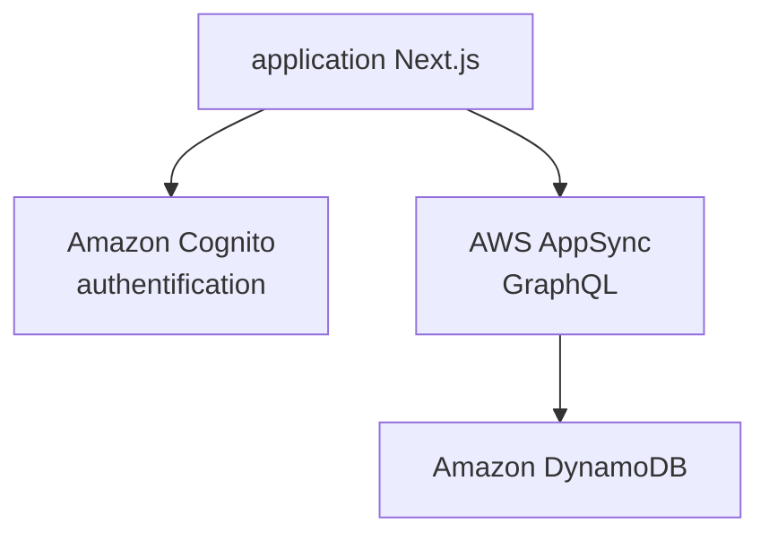

# aws-samples/amplify-next-template

> Modèle de départ Next.js (App Router) avec AWS Amplify : authentification, API GraphQL, base de données.

## Le problème
Brancher à la main Cognito, AppSync et DynamoDB sur une application Next.js prend du temps.

## Ce que ça fait vraiment
Fournit une application Next.js préconfigurée avec Amplify : authentification Amazon Cognito, API GraphQL AWS AppSync et base DynamoDB. Le déploiement est renvoyé à la documentation Amplify. README très court.

## Comment c'est branché
Schéma simplifié d'après la fiche, sans diagramme fourni.

## Essayer
Aucune commande documentée dans le README.

## Coût et pièges
Compte AWS requis ; les services AWS sont facturés selon l'usage. Dernier push en décembre 2024.

## Ce que ce n'est pas
Pas une application finie, seulement un gabarit. Pas d'instructions de déploiement dans le README.

## Alternatives
Non documenté dans le README.

## Pour toi
À ignorer : gabarit web AWS ancien, sans rapport avec un travail data, IA ou MLOps.

