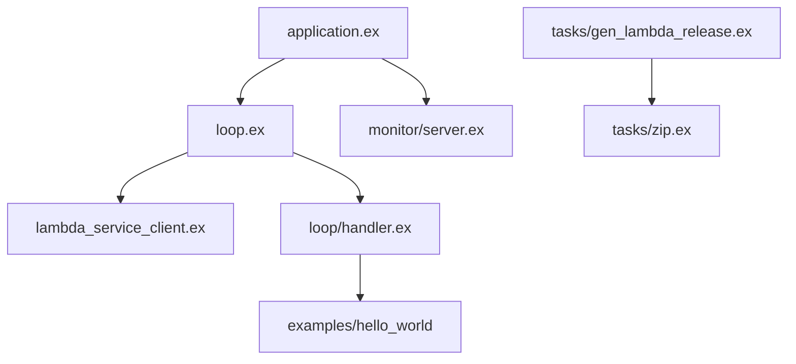

# aws-samples/aws-lambda-elixir-runtime

> Example custom runtime for running Elixir on AWS Lambda.

## The problem
Lambda does not support Elixir natively.

## What it actually does
Based on the code, a loop polls the Lambda API (`lambda_service_client.ex`) and delegates each invocation to the user's handler. Mix tasks generate the release and the zip archive. `hello_world` serves as an example. The README is minimal.

## How it is wired
Diagram based on the code diagram.



## Trying it
```bash
# mix.exs :
# {:lambda, "~> 0.1.0"}
```

## Cost and gotchas
Free (MIT-0), but execution on Lambda is billed by AWS. Elixir and an AWS account are required. Last push in August 2023.

## What it is not
Not a maintained library: an old "sample". The package is published on Hex only "if available".

## Alternatives
None cited in the README.

## For you
Ignore: old and poorly documented example, unrelated to data / AI / MLOps work.
