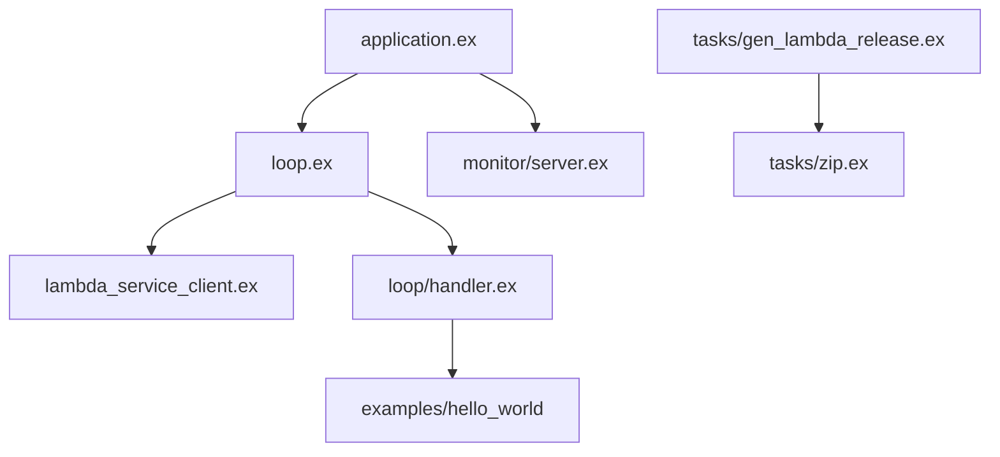

# aws-samples/aws-lambda-elixir-runtime

> Exemple de runtime personnalisé pour exécuter Elixir sur AWS Lambda.

## Le problème
Lambda ne prend pas Elixir en charge nativement.

## Ce que ça fait vraiment
D'après le code, une boucle interroge l'API Lambda (`lambda_service_client.ex`) et délègue chaque invocation au handler de l'utilisateur. Des tâches mix génèrent la release et l'archive zip. `hello_world` sert d'exemple. Le README est minimal.

## Comment c'est branché
Schéma d'après le diagramme du code.



## Essayer
```bash
# mix.exs :
# {:lambda, "~> 0.1.0"}
```

## Coût et pièges
Gratuit (MIT-0), mais l'exécution sur Lambda est facturée par AWS. Elixir et un compte AWS nécessaires. Dernier push en août 2023.

## Ce que ce n'est pas
Pas une bibliothèque maintenue : un exemple (« sample ») ancien. Le paquet n'est publié sur Hex que « s'il est disponible ».

## Alternatives
Aucune citée dans le README.

## Pour toi
Ignorer : exemple ancien et peu documenté, sans rapport avec un travail data / IA / MLOps.

