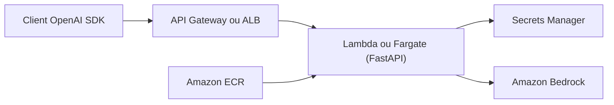

# aws-samples/bedrock-access-gateway

> OpenAI-compatible API proxy in front of Amazon Bedrock, now deprecated in favor of the native APIs.

## The problem
Use existing OpenAI SDKs with Bedrock models without changing the code.

## What it actually does
A FastAPI application deployed by CloudFormation, either API Gateway + Lambda (SSE streaming) or ALB + Fargate. Translates chat completions, embeddings, tool calls, multimodal, reasoning, prompt caching and application inference profiles to Bedrock. The proxy key is stored in Secrets Manager.

## How it is wired


## Trying it
```bash
git clone https://github.com/aws-samples/bedrock-access-gateway.git
cd bedrock-access-gateway/scripts
bash ./push-to-ecr.sh
```
Then deploy the CloudFormation template from the AWS console.

## Cost and gotchas
AWS billing (Lambda or Fargate, Bedrock, ECR); deployment takes about 10–15 minutes; access to Bedrock models must be requested. The README announces the project as deprecated.

## What it is not
No longer the recommended path: Amazon Bedrock natively offers OpenAI- and Anthropic-compatible APIs (`bedrock-mantle` endpoint).

## Alternatives
The native Bedrock APIs (`bedrock-mantle`), cited by the README.

## For you
Ignore: archived and deprecated repository; call the native Bedrock APIs directly.
