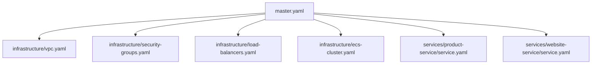

# aws-samples/ecs-refarch-cloudformation

> Reference architecture in CloudFormation templates for deploying microservices on Amazon ECS behind a load balancer.

## The problem
Manually setting up a VPC, an ECS cluster, load balancers and services is slow and hard to reproduce identically.

## What it actually does
- A master template `master.yaml` that nests the other templates.
- Deploys a two-zone VPC, an Auto Scaling ECS cluster, NAT gateways and an ALB with path-based routes.
- Provides two example services, website-service and product-service, with CloudWatch logs.
- Adds a Lambda that drains tasks before an instance is shut down.

## How it is wired


## Trying it
```bash
# Le README propose un bouton de lancement CloudFormation par région.
# Pour personnaliser : forker, modifier les modèles, les envoyer dans un bucket S3,
# puis déployer master.yaml ou mettre à jour la pile existante.
```

## Cost and gotchas
AWS account required and billed resources (t2.large instances, NAT gateways) at your expense. The cluster is fixed at 4 hosts with no automatic scaling.

## What it is not
Not an installable tool: an example to read and adapt. Archived repository, last push in 2023: versions and practices are dated.

## Alternatives
No alternative named in the README.

## For you
Ignore: an archived and dated ECS template, of little use for modern GPU-based MLOps; at best to keep as reference reading.
