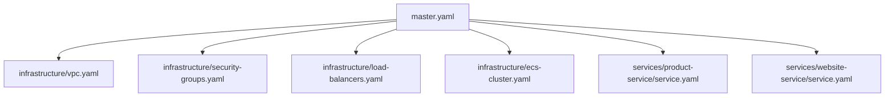

# aws-samples/ecs-refarch-cloudformation

> Architecture de référence en modèles CloudFormation pour déployer des microservices sur Amazon ECS derrière un load balancer.

## Le problème
Monter à la main un VPC, un cluster ECS, des load balancers et des services est long et difficile à reproduire à l'identique.

## Ce que ça fait vraiment
- Un modèle maître `master.yaml` qui imbrique les autres modèles.
- Déploie un VPC à deux zones, un cluster ECS en Auto Scaling, des NAT gateways et un ALB à routes par chemin.
- Fournit deux services d'exemple, website-service et product-service, avec logs CloudWatch.
- Ajoute une Lambda de drainage des tâches avant l'arrêt d'une instance.

## Comment c'est branché


## Essayer
```bash
# Le README propose un bouton de lancement CloudFormation par région.
# Pour personnaliser : forker, modifier les modèles, les envoyer dans un bucket S3,
# puis déployer master.yaml ou mettre à jour la pile existante.
```

## Coût et pièges
Compte AWS requis et ressources facturées (instances t2.large, NAT gateways) à ta charge. Le cluster est fixé à 4 hôtes sans mise à l'échelle automatique.

## Ce que ce n'est pas
Pas un outil installable : un exemple à lire et adapter. Dépôt archivé, dernier push en 2023 : les versions et pratiques datent.

## Alternatives
Aucune alternative nommée dans le README.

## Pour toi
À ignorer : gabarit ECS archivé et daté, peu utile pour du MLOps moderne sur GPU ; à garder au mieux comme lecture de référence.

