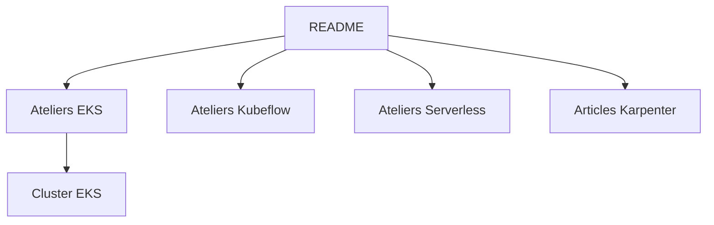

# aws-samples/eks-workshop-greater-china

> Index of AWS workshops in Chinese on EKS, Kubeflow and Karpenter, for teams in the Greater China region.

## The problem
Learning EKS step by step requires ordered hands-on labs, here mostly in Chinese.

## What it actually does
A list of workshop materials: EKS (Dashboard, ALB Ingress, EBS, EFS, IAM, autoscaling, Helm, Calico, EFK, Prometheus, Grafana, Istio), Kubeflow (notebooks, fairing, pipelines), serverless, CodePipeline, and Karpenter articles including one on GPU inference. The content of the steps is not in the README, only the titles.

## How it is wired
Simplified diagram based on the sheet, no diagram provided.

## Trying it
No command documented.

## Cost and gotchas
An AWS account is essential, the EKS resources created are billed. Materials mostly in Chinese.

## What it is not
Not a tool nor reusable code: a table of contents of hands-on labs dated 2019 to 2021.

## Alternatives
None cited except external resources (eksworkshop.com, eksctl documentation).

## For you
Ignore: dated materials in Chinese, archived; the official EKS and Kubeflow documentation replaces them.
