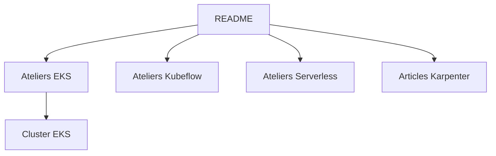

# aws-samples/eks-workshop-greater-china

> Index d'ateliers AWS en chinois sur EKS, Kubeflow et Karpenter, pour équipes de la région Grande Chine.

## Le problème
Apprendre EKS pas à pas demande des travaux pratiques ordonnés, ici surtout en chinois.

## Ce que ça fait vraiment
Une liste de supports d'ateliers : EKS (Dashboard, ALB Ingress, EBS, EFS, IAM, autoscaling, Helm, Calico, EFK, Prometheus, Grafana, Istio), Kubeflow (notebooks, fairing, pipelines), serverless, CodePipeline, et des articles Karpenter dont un sur l'inférence GPU. Le contenu des étapes n'est pas dans le README, seulement les titres.

## Comment c'est branché
Schéma simplifié d'après la fiche, sans diagramme fourni.

## Essayer
Aucune commande documentée.

## Coût et pièges
Compte AWS indispensable, les ressources EKS créées sont facturées. Supports en chinois pour l'essentiel.

## Ce que ce n'est pas
Pas un outil ni un code réutilisable : un sommaire de travaux pratiques datés de 2019 à 2021.

## Alternatives
Aucune citée sauf des ressources externes (eksworkshop.com, documentation eksctl).

## Pour toi
À ignorer : supports datés et en chinois, archivés ; la documentation officielle EKS et Kubeflow les remplace.

