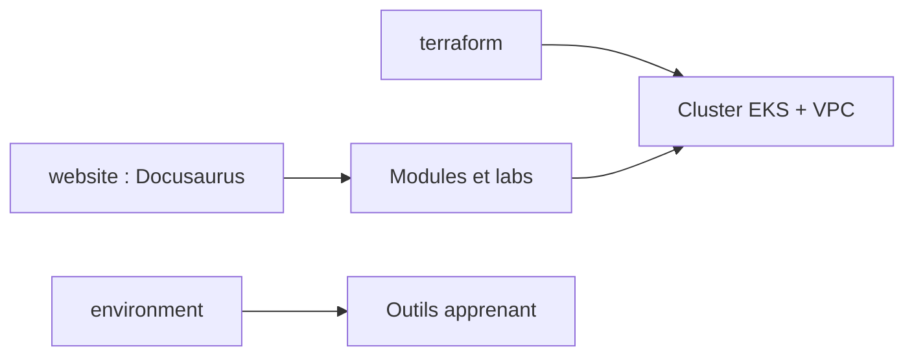

# aws-samples/eks-workshop-v2

> Official AWS workshop for learning Amazon EKS through modules, with Terraform infrastructure provided.

## The problem
Learning Kubernetes on EKS requires a consistent environment and up-to-date exercises.

## What it actually does
A Docusaurus site of standalone modules (networking, security, automation) built on a single demo application. The `terraform` folder creates the cluster, the VPC and the Helm charts. The `environment` folder installs tools such as kubectl. The steps are tested automatically.

## How it is wired
Simplified diagram based on the fiche, no diagram provided.

## Trying it
No command in the README: follow the Introduction chapter of the workshop site.

## Cost and gotchas
Resources created in your AWS account are billed. An AWS account is required.

## What it is not
Not a general Kubernetes course: it focuses on EKS. The modules are not meant as a production template.

## Alternatives
No alternative named in the README.

## For you
Worth watching: useful for building EKS skills if you deploy ML workloads on AWS, otherwise of little relevance.
