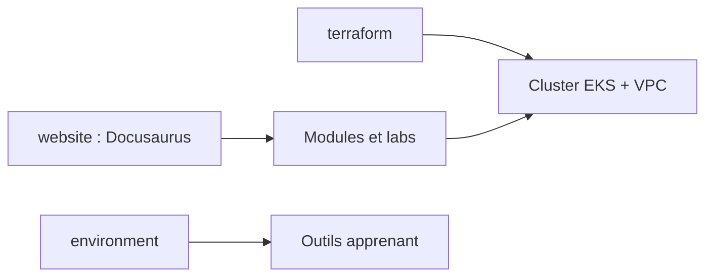

# aws-samples/eks-workshop-v2

> Atelier officiel AWS pour apprendre Amazon EKS par modules, avec infrastructure Terraform fournie.

## Le problème
Apprendre Kubernetes sur EKS demande un environnement cohérent et des exercices à jour.

## Ce que ça fait vraiment
Un site Docusaurus de modules autonomes (réseau, sécurité, automatisation) sur une même application de démonstration. Le dossier `terraform` crée le cluster, le VPC et les charts Helm. Le dossier `environment` installe les outils comme kubectl. Les étapes sont testées automatiquement.

## Comment c'est branché
Schéma simplifié d'après la fiche, sans diagramme fourni.

## Essayer
Aucune commande dans le README : suivre le chapitre Introduction du site de l'atelier.

## Coût et pièges
Les ressources créées dans ton compte AWS sont facturées. Un compte AWS est nécessaire.

## Ce que ce n'est pas
Ce n'est pas un cours général sur Kubernetes : il se concentre sur EKS. Les modules ne servent pas de modèle de production.

## Alternatives
Aucune alternative nommée dans le README.

## Pour toi
À surveiller : utile pour monter en compétence sur EKS si tu déploies des charges de travail ML sur AWS, sinon peu pertinent.

