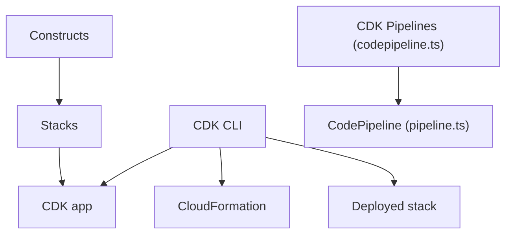

# aws/aws-cdk

> Framework for defining AWS infrastructure in a real programming language and deploying it through CloudFormation.

## The problem
CloudFormation templates in YAML or JSON are verbose, hard to reuse and lack the tooling of a programming language.

## What it actually does
You define constructs (reusable components) assembled into stacks and a CDK application, in TypeScript, Python, Java, .NET or Go. The `cdk` CLI synthesizes a CloudFormation template, deploys it and diffs against the deployed stack. The library covers every AWS service; a pipelines module (CDK Pipelines) builds CodePipelines.

## How it is wired


## Trying it
```sh
npm i -g aws-cdk
mkdir hello-cdk
cd hello-cdk
cdk init sample-app --language=typescript
cdk deploy
```

## Cost and gotchas
The CDK is free but the deployed AWS resources are billed to your account. The README mentions collection of anonymous operational metrics (can be disabled). Experimental modules can break the API on every release.

## What it is not
AWS only: not a multi-cloud tool. Not a server configuration provisioner. 2,935 open issues.

## Alternatives
No alternative named in the README (Construct Hub is cited as a library catalog).

## For you
Worth watching: the reference for AWS infrastructure as code if your MLOps is on AWS, but AWS lock-in and telemetry are worth knowing.
