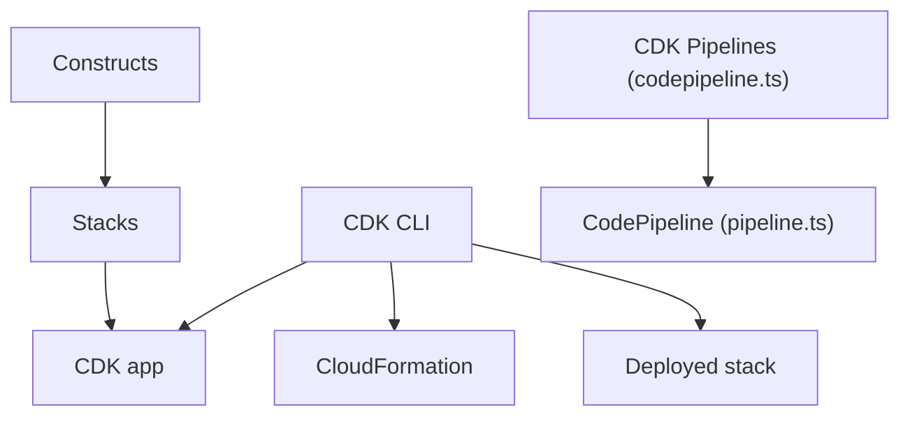

# aws/aws-cdk

> Framework pour définir l'infrastructure AWS dans un vrai langage de programmation et la déployer par CloudFormation.

## Le problème
Les modèles CloudFormation en YAML ou JSON sont verbeux, peu réutilisables et sans les outils d'un langage de programmation.

## Ce que ça fait vraiment
On définit des constructs (composants réutilisables) assemblés en stacks et en application CDK, en TypeScript, Python, Java, .NET ou Go. La CLI `cdk` synthétise un modèle CloudFormation, le déploie et compare avec la pile déployée. La bibliothèque couvre chaque service AWS ; un module de pipelines (CDK Pipelines) bâtit des CodePipeline.

## Comment c'est branché


## Essayer
```sh
npm i -g aws-cdk
mkdir hello-cdk
cd hello-cdk
cdk init sample-app --language=typescript
cdk deploy
```

## Coût et pièges
Le CDK est gratuit mais les ressources AWS déployées sont facturées sur ton compte. Le README signale une collecte de métriques opérationnelles anonymes (désactivable). Les modules expérimentaux peuvent casser l'API à chaque version.

## Ce que ce n'est pas
Ne vise qu'AWS : pas un outil multi-cloud. Ce n'est pas un provisionneur de configuration de serveurs. 2 935 issues ouvertes.

## Alternatives
Aucune alternative nommée dans le README (la Construct Hub est citée comme catalogue de bibliothèques).

## Pour toi
À surveiller : référence pour l'infrastructure AWS en code si ton MLOps est sur AWS, mais le verrouillage AWS et la télémétrie sont à connaître.

