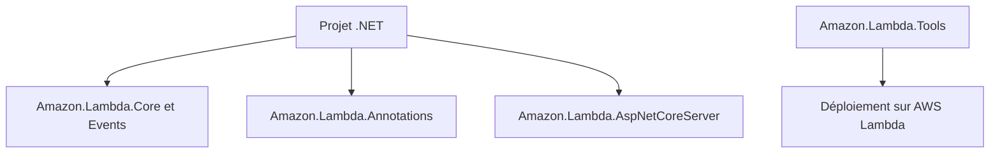

# aws/aws-lambda-dotnet

> NuGet packages and templates for writing AWS Lambda functions in .NET.

## The problem
Writing a Lambda function in .NET requires event types, a deployment tool and project templates.

## What it actually does
The repository provides the event classes (API Gateway, S3, SQS, DynamoDB, Kinesis...), the `Amazon.Lambda.Tools` tool to deploy from the CLI, the Annotations library, `AspNetCoreServer` to run an ASP.NET Core API, testing utilities and the Durable Execution SDK. `dotnet new` templates bootstrap a project.

## How it is wired
Simplified diagram based on the sheet, no diagram provided.



## Trying it
```bash
dotnet tool install -g Amazon.Lambda.Tools
dotnet new -i "Amazon.Lambda.Templates::*"
dotnet new lambda.EmptyFunction --name BlogFunction --profile default --region us-east-2
```

## Cost and gotchas
The packages are free, but an AWS account is required and Lambda executions are billed by AWS. The Yeoman generators are deprecated.

## What it is not
Not a multi-cloud serverless framework: it targets Lambda only and the .NET language.

## Alternatives
- No alternative named in the README.

## For you
Ignore unless your team writes .NET on AWS: no contribution for data, AI or MLOps.
