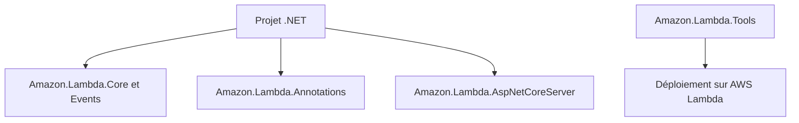

# aws/aws-lambda-dotnet

> Paquets NuGet et modèles pour écrire des fonctions AWS Lambda en .NET.

## Le problème
Écrire une fonction Lambda en .NET demande des types d'événements, un outil de déploiement et des modèles de projet.

## Ce que ça fait vraiment
Le dépôt fournit les classes d'événements (API Gateway, S3, SQS, DynamoDB, Kinesis...), l'outil `Amazon.Lambda.Tools` pour déployer depuis la CLI, la bibliothèque Annotations, `AspNetCoreServer` pour faire tourner une API ASP.NET Core, les utilitaires de test et le SDK Durable Execution. Des modèles `dotnet new` démarrent un projet.

## Comment c'est branché
Schéma simplifié d'après la fiche, sans diagramme fourni.



## Essayer
```bash
dotnet tool install -g Amazon.Lambda.Tools
dotnet new -i "Amazon.Lambda.Templates::*"
dotnet new lambda.EmptyFunction --name BlogFunction --profile default --region us-east-2
```

## Coût et pièges
Les paquets sont gratuits, mais un compte AWS est requis et les exécutions Lambda sont facturées par AWS. Les générateurs Yeoman sont dépréciés.

## Ce que ce n'est pas
Pas un framework serverless multi-cloud : il vise Lambda seulement et le langage .NET.

## Alternatives
- Aucune alternative nommée dans le README.

## Pour toi
À ignorer sauf si ton équipe écrit du .NET sur AWS : aucun apport pour data, IA ou MLOps.

