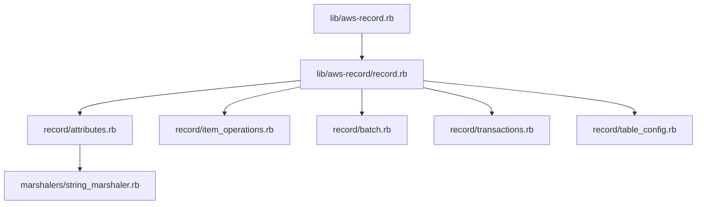

# aws/aws-record-ruby

> Ruby gem that maps object models onto DynamoDB, for AWS's Ruby developers.

## The problem
Hand-writing AWS SDK calls for DynamoDB (keys, types, batches, transactions) is verbose and repetitive.

## What it actually does
An `Aws::Record` module to include in a class: you declare typed attributes (`integer_attr`, `string_attr`, hash and range keys), then use `find`, `save`, `update`, `delete!`. It also covers BatchGetItem, BatchWriteItem, TransactGetItems and TransactWriteItems, and a `TableConfig` DSL to create the table.

## How it is wired


## Trying it
```bash
gem install 'aws-record'
```
```ruby
class MyModel
  include Aws::Record
  integer_attr :id, hash_key: true
  string_attr  :name, range_key: true
end
```

## Cost and gotchas
You need Ruby and an AWS account with DynamoDB: DynamoDB billing is on you (not detailed in the README). Depends on `aws-sdk-dynamodb`.

## What it is not
Not a SQL ORM: it only talks to DynamoDB. It does not replace the SDK, it builds on it.

## Alternatives
No alternative named in the README.

## For you
Ignore: a Ruby/DynamoDB tool unrelated to a Python data/AI/MLOps profile, unless you maintain a Ruby app on DynamoDB.
