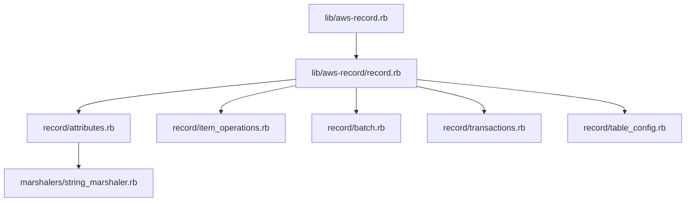

# aws/aws-record-ruby

> Gem Ruby qui mappe des modèles objets sur DynamoDB, pour les développeurs Ruby d'AWS.

## Le problème
Écrire à la main les appels du SDK AWS pour DynamoDB (clés, types, lots, transactions) est verbeux et répétitif.

## Ce que ça fait vraiment
Un module `Aws::Record` à inclure dans une classe : on déclare des attributs typés (`integer_attr`, `string_attr`, clés de hachage et de tri), puis `find`, `save`, `update`, `delete!`. Il couvre aussi BatchGetItem, BatchWriteItem, TransactGetItems et TransactWriteItems, et un DSL `TableConfig` pour créer la table.

## Comment c'est branché


## Essayer
```bash
gem install 'aws-record'
```
```ruby
class MyModel
  include Aws::Record
  integer_attr :id, hash_key: true
  string_attr  :name, range_key: true
end
```

## Coût et pièges
Il faut Ruby et un compte AWS avec DynamoDB : la facturation DynamoDB est à ta charge (non détaillée dans le README). Dépend de `aws-sdk-dynamodb`.

## Ce que ce n'est pas
Pas un ORM SQL : il ne parle que DynamoDB. Il ne remplace pas le SDK, il s'appuie dessus.

## Alternatives
Aucune alternative nommée dans le README.

## Pour toi
Ignorer : outil Ruby/DynamoDB sans rapport avec un profil data/IA/MLOps Python, sauf si tu maintiens une appli Ruby sur DynamoDB.

