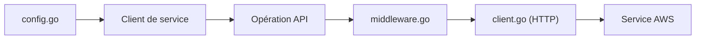

# aws/aws-sdk-go-v2

> Official AWS SDK for Go: a typed client per service, with pagination, waiters and signing.

## The problem
Calling AWS APIs by hand requires signing, retries and serialization for each service.

## What it actually does
Loads the config (environment variables, shared files), builds a client per service, and calls typed operations through a middleware stack (signing, retries, HTTP transport). Extensions: DynamoDB values and expressions, CloudFront signing, DSQL tokens. Go 1.24 minimum.

## How it is wired


## Trying it
```sh
go mod init helloaws
go get github.com/aws/aws-sdk-go-v2/aws
go get github.com/aws/aws-sdk-go-v2/config
go get github.com/aws/aws-sdk-go-v2/service/dynamodb
go run .
```

## Cost and gotchas
The SDK is free; AWS calls are billed and require credentials.

## What it is not
Not multi-cloud. The README gives no list of services.

## Alternatives
The previous version of the Go SDK (migration guide cited in the README).

## For you
Relevant only if your Go code talks to AWS; in Python, boto3 is outside this repository: ignore here.
