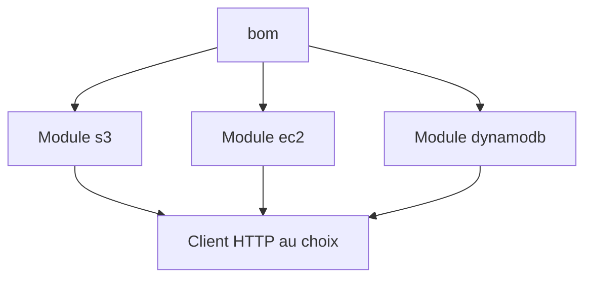

# aws/aws-sdk-java-v2

> AWS's Java development kit, with non-blocking I/O, for calling AWS services from Java.

## The problem
Calling S3, EC2 or DynamoDB in Java without an official client forces you to handle signatures and protocols yourself.

## What it actually does
One Maven module per AWS service, a BOM to align versions and a global package. Synchronous and asynchronous clients, HTTP implementation of your choice. Requires Java 1.8 or later.

## How it is wired
Simplified diagram based on the sheet, no diagram provided.


## Trying it
```bash
./mvnw clean install
./mvnw clean install -P quick
./mvnw clean install -pl :s3 -P quick --am
```

## Cost and gotchas
The SDK is free, but you need an AWS account and its credentials; calls are billed by AWS. Java required (not listed: `none` for the SDK itself, the account remains the real requirement).

## What it is not
Not a Python SDK: for Python, this is not the right tool. Not a service: only a client.

## Alternatives
No alternative named in the README.

## For you
Ignore: unless you have a Java stack on AWS, a data / AI / MLOps profile uses the Python SDK.
