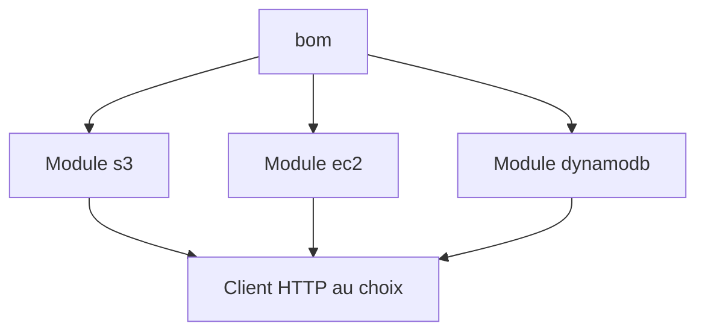

# aws/aws-sdk-java-v2

> Kit de développement Java d'AWS, avec entrées-sorties non bloquantes, pour appeler les services AWS depuis Java.

## Le problème
Appeler S3, EC2 ou DynamoDB en Java sans client officiel oblige à gérer signatures et protocoles soi-même.

## Ce que ça fait vraiment
Un module Maven par service AWS, un BOM pour aligner les versions et un paquet global. Clients synchrones et asynchrones, implémentation HTTP au choix. Nécessite Java 1.8 ou plus.

## Comment c'est branché
Schéma simplifié d'après la fiche, sans diagramme fourni.


## Essayer
```bash
./mvnw clean install
./mvnw clean install -P quick
./mvnw clean install -pl :s3 -P quick --am
```

## Coût et pièges
Le SDK est gratuit, mais il faut un compte AWS et ses identifiants ; les appels sont facturés par AWS. Java requis (non listé : `aucun` pour le SDK lui-même, le compte reste le vrai besoin).

## Ce que ce n'est pas
Pas un SDK Python : pour Python, ce n'est pas le bon outil. Pas un service : seulement un client.

## Alternatives
Aucune alternative nommée dans le README.

## Pour toi
Ignorer : sauf pile Java sur AWS, un profil data / IA / MLOps utilise le SDK Python.

