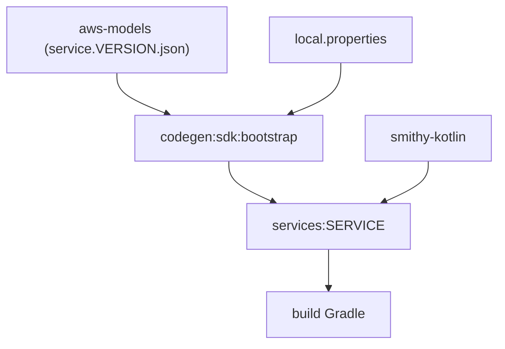

# aws/aws-sdk-kotlin

> Amazon's official Kotlin SDK for calling AWS services, with its public roadmap.

## The problem
Calling AWS services from Kotlin requires typed, asynchronous, up-to-date clients.

## What it actually does
Clients are generated from the service models by Gradle: the generated code is not in the repository. You generate the services you want (`aws.services`, `aws.protocols`) then build them. API docs are produced with Dokka.

## How it is wired


## Trying it
```bash
./gradlew --no-daemon :codegen:sdk:bootstrap
./gradlew :services:lambda:build
./gradlew --no-daemon -Paws.services=+lambda :codegen:sdk:bootstrap
```

## Cost and gotchas
The SDK is free, but AWS calls are billed to your account. You need Gradle and the JVM (Java and Kotlin are not in the prerequisites list). Local tests require publishing other repositories to local Maven.

## What it is not
Not a Python SDK: for data work, boto3 is the usual path.

## Alternatives
No alternative named in the README.

## For you
Ignore, unless you have a Kotlin/JVM project on AWS: in data/MLOps you will more likely use the Python SDK.
